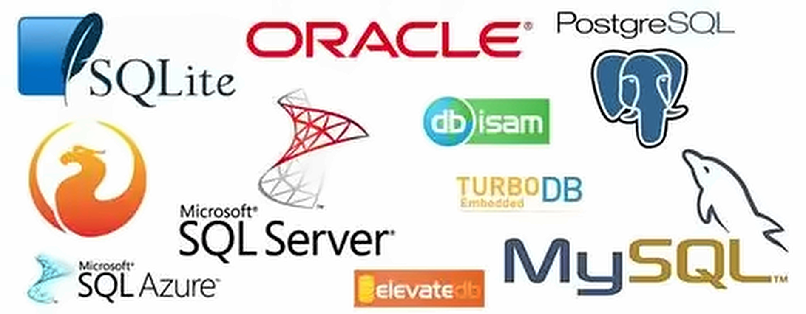

## Introdução

::::: lado
<div>

Neste módulo você vai entender:

-   O que são dados
-   O que são bancos de dados
-   Qual a relação disso tudo com SQL

Ao final, você vai entender onde está "se metendo" e por que SQL é mais
importante do que imagina.

</div>

::: {.painel .fragment}
Onde isso é usado no dia a dia?

-   Sistemas de hospital
-   Aplicativos de banco
-   E-commerce
-   Prontuário eletrônico
:::
:::::

## O que é um dado?

::::: lado
<div>

Definição simples: dado é qualquer informação bruta.

-   Nome
-   Idade
-   Resultado de exame
-   Data de atendimento

</div>

::: {.painel .fragment}
Exemplo no contexto de saúde: dados de um paciente, dados de uma
consulta.
:::
:::::

## Exemplo: um banco de dados na saúde

::: nota
Banco de dados para manter informações referentes a pacientes, médicos,
consultas e exames em um ambiente hospitalar (trecho das tabelas).
:::

::::: lado
::: {.tb .tb-pk}
PACIENTE

| id_paciente | nome  | idade |  cidade   |
|:-----------:|:-----:|:-----:|:---------:|
|      1      | Maria |  39   | Fortaleza |
|      2      | João  |  52   |  Recife   |
|      3      |  Ana  |  27   |   Natal   |
:::

::: {.tb .tb-pk}
MEDICO

| id_medico |    nome     |  crm  | especialidade |
|:---------:|:-----------:|:-----:|:-------------:|
|     1     |  Dr. Paulo  | 10234 |  Cardiologia  |
|     2     | Dra. Helena | 20871 |   Ortopedia   |
|     3     | Dra. Clara  | 30456 | Dermatologia  |
:::
:::::

::::: lado
::: {.tb .tb-pk .tb-fk}
CONSULTA

| id_consulta | id_paciente | id_medico | data  |
|:-----------:|:-----------:|:---------:|:-----:|
|     10      |      1      |     1     | 12/08 |
|     11      |      2      |     2     | 13/08 |
|     13      |      3      |     3     | 14/08 |
:::

::: {.tb .tb-pk .tb-fk}
EXAME

| id_exame | id_consulta |   tipo   | resultado |
|:--------:|:-----------:|:--------:|:---------:|
|   501    |     10      | Cardíaco |  Normal   |
|   502    |     11      |  Imagem  | Alterado  |
|   503    |     13      |  Sangue  |  Normal   |
:::
:::::

::: {.nota .fragment}
Repare que as tabelas se ligam umas às outras (`id_paciente`,
`id_medico`, `id_consulta`). Ao longo do módulo vamos entender cada peça
desse quebra-cabeça.
:::

## Dado x Informação

:::::: lado
::: {.painel .neutro}
Dados soltos:

> "Maria" "39" "12/08" "Cardiologia"
:::

::: {.seta .fragment data-fragment-index="1"}
→
:::

::: {.painel .fragment data-fragment-index="1"}
Os mesmos dados organizados, com sentido:

> "Maria, 39 anos, consulta em 12/08 com Cardiologia"
:::
::::::

::: {.nota .fragment}
Informação é o dado com contexto e significado: o dado depois de
organizado e interpretado.
:::

::: {.nota .fragment}
Agora dá para saber que a Maria tem consulta marcada com a Cardiologia.

O "39" sozinho não diz nada.
:::

## O que é um Banco de Dados?

Como vimos anteriormente, um dado é uma informação que nos permite
chegar ao conhecimento de algo. Um dado isolado por si só já tem um
grande valor. Em conjunto com outros dados então, ele é mais valioso
ainda.

::::::::::: fluxo
:::: caixa
::: {.titulo .t1}
Dado
:::

-   1 Compra online
-   1 transferência bancária
-   1 curtida em uma foto do Instagram
::::

::: seta
→
:::

:::: caixa
::: {.titulo .t2}
Tabela
:::

-   Diversas compras online
-   Diversas transferências bancárias
-   Diversas curtidas em fotos do Instagram
::::

::: seta
→
:::

:::: caixa
::: {.titulo .t3}
Banco de Dados
:::

-   Informações de compras online, usuários, histórico de produtos, etc
-   Informações de contas bancárias, histórico de transferências, dados
    dos usuários, etc
-   Curtidas em fotos, informações de preferências dos usuários, etc
::::
:::::::::::

## Por que não usar planilha pra tudo?

Um lugar onde os dados ficam organizados e guardados de forma
estruturada resolve problemas que uma planilha não resolve bem:

-   Volume de dados
-   Duplicidade de informação
-   Dificuldade de relacionar dados

::::: lado
::: {.nota .fragment}
Concorrência: várias pessoas mexendo no mesmo arquivo ao mesmo tempo.
:::

::: {.nota .fragment}
Confiabilidade das informações: o banco aplica regras (tipo do dado,
campos obrigatórios, chaves) que evitam dados errados, duplicados ou
"órfãos", como uma consulta para um paciente que não existe.
:::
:::::

::::: lado
::: {.nota .fragment}
Segurança dos dados: controle de acesso por perfil (nem todo mundo pode
ver ou alterar tudo), registro de quem acessou e backup para recuperar o
que for perdido.
:::

::: {.nota .fragment}
Na saúde isso pesa ainda mais: dados de pacientes são dados sensíveis,
protegidos pela LGPD (Lei nº 13.709/2018).
:::
:::::

----------------------------------------------------------------------

### SGBD (Sistema de Gerenciamento de Banco de Dados)

O SGBD é o programa que gerencia o banco: cria, organiza, protege e
permite consultar os dados.

::: {.nota .fragment}
Sem SGBD, a organização e a busca do dado seriam manuais. Com SGBD, isso
é automatizado.
:::

::: fragment
Exemplos:

{fig-align="center" width="70%"}
:::

::: {.nota .fragment}
O SGBD é quem "fala" SQL ou seja, SQL é a linguagem, SGBD é quem
interpreta e executa essa linguagem.
:::

## Onde entra o SQL?

::::::: lado
<div>

SQL (*Structured Query Language*, ou Linguagem de Consulta Estruturada)
é a linguagem padrão usada para "conversar" com o SGBD: criar, consultar
e alterar os dados organizados em bancos de dados relacionais.

::: fragment
``` sql
SELECT nome FROM paciente;
```
:::

::: fragment
SQL "pergunta" coisas ao banco em um português quase legível.
:::

</div>

::: {.painel .fragment}
Antes de aprender SQL, você precisa entender:

1.  O que é dado
2.  O que é banco de dados
3.  Quem gerencia isso (SGBD)
4.  Como isso se relaciona

Só depois faz sentido escrever a primeira query.
:::
:::::::

## Entidade

Entidade é um grupo de informações ligadas entre se, necessárias para o
funcionamento do sistema. Normalmente representa algo do mundo real.

::: {.nota .fragment}
No banco de dados, cada entidade vira uma tabela.
:::

::: {.nota .fragment}
Uma entidade tem várias ocorrências: a entidade é "paciente" e a Maria é
uma ocorrência dela.
:::

## Exemplos e Tipos de Entidade

| Categoria          | Exemplos                                            |
|:-------------------|:----------------------------------------------------|
| Pessoas e empresas | paciente, funcionário, cliente, fornecedor, empresa |
| Documentos         | ordem de compra, pedido, nota fiscal                |
| Lugares            | almoxarifado, departamento                          |
| Tabelas de apoio   | classificação fiscal, centro de custo, UF           |
| Materiais          | produto, peça                                       |

::::::::: fragment
As entidades se dividem em dois tipos:

::::: def
::: term
Fundamental
:::

::: desc
Guarda os dados básicos do sistema (paciente, médico)
:::
:::::

::::: {.def .mint}
::: term
Associativa
:::

::: desc
Nasce da relação entre duas entidades fundamentais (consulta liga
paciente e médico)
:::
:::::
:::::::::

## Atributo e Tupla

::: {.tb .tb-tupla .c4}
Tabela paciente

| id_paciente | nome  | idade |  cidade   |
|:-----------:|:-----:|:-----:|:---------:|
|      1      | Maria |  39   | Fortaleza |
|      2      | João  |  52   |  Recife   |
|      3      |  Ana  |  27   |   Natal   |
:::

::::::::: lado
::::: {.def .fragment}
::: term
Atributo
:::

::: desc
Cada característica da entidade. Vira uma coluna (campo). Exemplo: nome,
idade, cidade.
:::
:::::

::::: {.def .mint .fragment}
::: term
Tupla
:::

::: desc
O conjunto de atributos de uma ocorrência. Vira uma linha (registro).
Exemplo: 1, Maria, 39, Fortaleza.
:::
:::::
:::::::::

::: {.nota .fragment}
Atributo não é entidade: o atributo é uma característica, e a entidade é
o grupo de atributos (no mínimo dois).
:::

::: {.nota .fragment}
E como saber qual tupla é qual? Algum atributo precisa identificar cada
linha de forma única. É aí que entram as chaves.
:::

## Chaves

::::: def
::: term
Chave primária (PK)
:::

::: desc
A chave primária deve ser única e imutável para cada linha da entidade.
Toda tabela precisa ter uma: é ela que identifica cada registro.

Exemplo: `id_paciente` na tabela paciente e `id_consulta` na tabela
consulta
:::
:::::

::::: {.def .mint}
::: term
Chave Estrangeira (FK)
:::

::: desc
É a coluna de uma tabela que aponta para a chave primária de outra
tabela. É ela que cria o relacionamento entre as tabelas.

Exemplo: `id_paciente` na tabela consulta aponta para `id_paciente` na
tabela paciente
:::
:::::

::::: {.def .slate}
::: term
Chave secundária (SK)
:::

::: desc
É uma coluna usada para buscar os dados com mais rapidez, mas que pode
se repetir (não identifica a linha sozinha).

Exemplo: `especialidade`, `nome`
:::
:::::

## Exemplos de Chaves

:::::: lado
::: {.tb .tb-pk}
Chave primária

| id_paciente | nome  | idade |
|:-----------:|:-----:|:-----:|
|      1      | Maria |  39   |
|      2      | João  |  52   |
:::

::: {.tb .tb-fk}
Chave estrangeira

| id_consulta | id_paciente | especialidade |
|:-----------:|:-----------:|:-------------:|
|     10      |      1      |  Cardiologia  |
|     11      |      2      |   Ortopedia   |
:::

::: {.tb .tb-sk}
Chave secundária

| id_consulta | id_paciente | especialidade |
|:-----------:|:-----------:|:-------------:|
|     10      |      1      |  Cardiologia  |
|     11      |      2      |   Ortopedia   |
:::
::::::

::: {.nota .fragment}
Juntando as três em uma tabela só:
:::

::::: {.lado .fragment}
::: {.tb .tb-pk}
Tabela paciente

| id_paciente | nome  |  cidade   |
|:-----------:|:-----:|:---------:|
|      1      | Maria | Fortaleza |
|      2      | João  |  Recife   |
:::

::: {.tb .tb-pk .tb-fk .tb-sk}
Tabela consulta

| id_consulta | id_paciente | especialidade |
|:-----------:|:-----------:|:-------------:|
|     10      |      1      |  Cardiologia  |
|     11      |      2      |   Ortopedia   |
:::
:::::

## Funções Básicas do SQL

Agora que já entendemos dados, tabelas e chaves, vamos conhecer os
comandos que usamos para trabalhar com eles.

| Função            | O que faz                              |
|:------------------|:---------------------------------------|
| `CREATE DATABASE` | Cria o banco de dados                  |
| `CREATE TABLE`    | Cria uma tabela dentro do banco        |
| `INSERT INTO`     | Adiciona uma nova linha na tabela      |
| `SELECT`          | Escolhe as colunas que você quer ver   |
| `FROM`            | Diz de qual tabela os dados vêm        |
| `WHERE`           | Filtra as linhas por uma condição      |
| `ORDER BY`        | Ordena o resultado                     |
| `COUNT()`         | Conta quantas linhas existem           |
| `UPDATE`          | Altera dados que já existem            |
| `DELETE`          | Remove linhas da tabela                |

::: {.nota .fragment}
Nos próximos slides vamos ver na prática como criar, inserir, alterar e
remover dados.
:::

## Criando um Banco de Dados (CREATE DATABASE)

Antes de criar as tabelas, precisamos criar o banco onde elas vão morar.

``` sql
CREATE DATABASE hospital;
```

::: fragment
``` sql
USE hospital;
```
:::

::: {.nota .fragment}
`CREATE DATABASE` cria o banco vazio. `USE` diz ao SGBD qual banco vamos
usar dali pra frente.
:::

## Tipos de Dados

Cada atributo (coluna) precisa de um **tipo**, que diz ao SGBD que valor
a coluna aceita.

| Tipo | O que guarda | Exemplo na saúde |
|:-----------------------|:-----------------------|:-----------------------|
| Texto (caracteres): `VARCHAR` | Letras, palavras, símbolos | nome, cidade, especialidade |
| Número inteiro: `INT` | Números sem casas decimais | idade, id_paciente |
| Número decimal: `DECIMAL` | Números com casas decimais | peso, altura, valor da consulta |
| Data e hora: `DATE`, `DATETIME` | Datas e horários | data da consulta |
| Lógico: `BOOLEAN` | Verdadeiro ou falso | paciente em jejum? |

::: {.nota .fragment}
Escolher o tipo certo evita erros: não dá para guardar "abc" em uma
coluna de idade.
:::

::: {.nota .fragment}
CPF e telefone ficam como texto, não como número: não fazemos conta com
eles e o zero à esquerda não pode se perder.
:::

::: {.nota .fragment}
Os nomes dos tipos variam um pouco entre SGBDs (MySQL, PostgreSQL, SQL
Server), mas a ideia é a mesma.
:::

## Criando uma Tabela (CREATE TABLE)

O `CREATE TABLE` cria a tabela dentro do banco: dá um nome a ela e diz o
nome, o tipo e as chaves de cada coluna.

``` sql
CREATE TABLE paciente (
    id_paciente INT PRIMARY KEY,
    nome        VARCHAR(100),
    idade       INT,
    cidade      VARCHAR(100)
);
```

::: fragment
``` sql
CREATE TABLE consulta (
    id_consulta   INT PRIMARY KEY,
    id_paciente   INT,
    especialidade VARCHAR(100),
    data          DATE,
    FOREIGN KEY (id_paciente) REFERENCES paciente(id_paciente)
);
```
:::

::: {.nota .fragment}
`PRIMARY KEY` marca a chave primária, e `FOREIGN KEY ... REFERENCES`
cria a chave estrangeira: é o mesmo relacionamento que vimos em Chaves,
agora em código.
:::

::: {.nota .fragment}
Mais à frente, em Integridade, vamos acrescentar regras como `NOT NULL`,
`CHECK` e `UNIQUE` a essas tabelas.
:::

## Inserindo dados (INSERT INTO)

Com as tabelas criadas, usamos o `INSERT INTO` para colocar dados em
qualquer tabela do banco.

``` sql
INSERT INTO tabela (coluna1, coluna2)
VALUES
    (valor1, valor2),
    (valor1, valor2);
```

::::::::: lado
::::: {.def .fragment}
::: term
`INSERT INTO tabela (colunas)`
:::

::: desc
Diz em qual tabela e em quais colunas os dados vão entrar.
:::
:::::

::::: {.def .mint .fragment}
::: term
`VALUES`
:::

::: desc
Cada parêntese é uma linha nova. A ordem dos valores precisa bater com a
ordem das colunas.
:::
:::::
:::::::::

## INSERT INTO na prática: nosso hospital

``` sql
INSERT INTO paciente (id_paciente, nome, idade, cidade)
VALUES
    (1, 'Maria',   39, 'Fortaleza'),
    (2, 'João',    52, 'Recife'),
    (3, 'Ana',     27, 'Natal'),
    (4, 'Carlos',  45, 'João Pessoa'),
    (5, 'Beatriz', 63, 'Sobral');
```

::: fragment
``` sql
INSERT INTO consulta (id_consulta, id_paciente, especialidade, data)
VALUES
    (10, 1, 'Cardiologia', '2026-08-12'),
    (11, 2, 'Ortopedia',   '2026-08-13'),
    (12, 1, 'Nutrição',    '2026-08-20'),
    (13, 3, 'Dermatologia','2026-08-14'),
    (14, 5, 'Cardiologia', '2026-08-15');
```
:::

::: {.nota .fragment}
Texto e datas vão entre aspas simples; números, sem aspas. A data segue
o formato AAAA-MM-DD, do tipo `DATE`.
:::

::: {.nota .fragment}
A ordem importa: insira primeiro em `paciente` e depois em `consulta`,
porque a chave estrangeira só aceita um `id_paciente` que já existe.
Essas são as linhas que aparecem no próximo slide.
:::

## Estrutura de Relacionamento

Os dados dentro do banco não ficam soltos: ficam organizados em tabelas,
e as tabelas se relacionam entre si.

::::: lado
::: {.tb .tb-pk}
Tabela paciente

| id_paciente |  nome   | idade |   cidade    |
|:-----------:|:-------:|:-----:|:-----------:|
|      1      |  Maria  |  39   |  Fortaleza  |
|      2      |  João   |  52   |   Recife    |
|      3      |   Ana   |  27   |    Natal    |
|      4      | Carlos  |  45   | João Pessoa |
|      5      | Beatriz |  63   |   Sobral    |
:::

::: {.tb .tb-pk .tb-fk}
Tabela consulta (relacionada por `id_paciente`)

| id_consulta | id_paciente | especialidade | data  |
|:-----------:|:-----------:|:-------------:|:-----:|
|     10      |      1      |  Cardiologia  | 12/08 |
|     11      |      2      |   Ortopedia   | 13/08 |
|     12      |      1      |   Nutrição    | 20/08 |
|     13      |      3      | Dermatologia  | 14/08 |
|     14      |      5      |  Cardiologia  | 15/08 |
:::
:::::

::: {.nota .fragment}
Essa relação é o que dá sentido ao banco de dados. Repare que Maria
(`id_paciente` = 1) aparece em duas consultas, e Carlos ainda não tem
nenhuma.
:::

::: {.nota .fragment}
`id_paciente` (PK) → `id_paciente` (FK) · cardinalidade **1 : N**
:::

## Tipos de Relacionamento

Um relacionamento diz **quantas linhas** de uma tabela se ligam a
quantas linhas da outra.

:::::::::::: lado
::::: tipo
::: num
1:1
:::

Uma linha se liga a uma linha da outra tabela

::: ex
Paciente e prontuário
:::
:::::

::::: {.tipo .t-n}
::: num
1:N
:::

Uma linha se liga a várias linhas da outra tabela

::: ex
Um paciente e suas consultas
:::
:::::

::::: {.tipo .t-nn}
::: num
N:N
:::

Várias linhas se ligam a várias linhas da outra tabela

::: ex
Pacientes e médicos
:::
:::::
::::::::::::

::: {.nota .fragment}
No exemplo anterior, paciente → consulta é 1:N: um paciente pode ter
várias consultas, mas cada consulta pertence a um só paciente. A chave
estrangeira `id_paciente` fica do lado do N.
:::

::: {.nota .fragment}
O N:N precisa de uma tabela no meio: um paciente passa por vários
médicos e um médico atende vários pacientes, então a tabela consulta
guarda `id_paciente` e `id_medico`.
:::

---

### Outro exemplo: Loja online

Mesma ideia, outra área: um cliente pode fazer vários pedidos.

::::: lado
::: {.tb .tb-pk}
Tabela cliente

| id_cliente |  nome  |     cidade     |
|:----------:|:------:|:--------------:|
|     1      | Lucas  |   Fortaleza    |
|     2      | Paula  |     Recife     |
|     3      | Renata |     Natal      |
|     4      | Pedro  |  João Pessoa   |
|     5      | Camila | Campina Grande |
:::

::: {.tb .tb-pk .tb-fk}
Tabela pedido (relacionada por `id_cliente`)

| id_pedido | id_cliente |    produto     | valor (R\$) |
|:---------:|:----------:|:--------------:|:-----------:|
|    100    |     1      | Fone de ouvido |   150,00    |
|    101    |     2      |    Teclado     |   220,00    |
|    102    |     1      |     Mouse      |    80,00    |
|    103    |     4      |    Monitor     |   900,00    |
|    104    |     5      |   Cabo HDMI    |    35,00    |
:::
:::::

::: {.nota .fragment}
Também é um 1:N: Lucas (`id_cliente` = 1) tem dois pedidos, e cada
pedido pertence a um só cliente. Trocando os nomes das tabelas, a
estrutura é a mesma do hospital.
:::

## Alterando e removendo dados (UPDATE e DELETE)

``` sql
UPDATE tabela
SET coluna = novo_valor
WHERE condição;
```

::: fragment
``` sql
DELETE FROM tabela
WHERE condição;
```
:::

::::::: lado
::::: {.def .fragment}
::: term
`UPDATE` / `SET`
:::

::: desc
Atualiza a tabela. O `SET` define qual coluna receberá o novo valor.
:::
:::::

::::: {.def .mint .fragment}
::: term
`DELETE`
:::

::: desc
Apaga (exclui) os registros que atenderem à condição.
:::
:::::
:::::::

::: {.erro .fragment}
`WHERE` é obrigatório! Sem ele, TODAS as linhas da tabela são alteradas ou
apagadas.
:::

## UPDATE e DELETE na prática

``` sql
-- Maria mudou de cidade
UPDATE paciente
SET cidade = 'Campina Grande'
WHERE id_paciente = 1;
```

::: fragment
``` sql
-- Cancelar a consulta 14
DELETE FROM consulta
WHERE id_consulta = 14;
```
:::

::: {.nota .fragment}
A condição quase sempre usa a chave primária (`id_paciente`,
`id_consulta`), porque ela identifica uma única linha.
:::

::: {.erro .fragment}
Sem o `WHERE`, `UPDATE paciente SET cidade = 'Campina Grande';` muda a
cidade de todos os pacientes, e `DELETE FROM consulta;` apaga todas as
consultas.
:::

## Integridade de dados

**Integridade de dados** é o conjunto de regras que mantém os dados
corretos, consistentes e válidos durante todo o seu ciclo de vida. Essas
regras impedem, por exemplo, que:

-   dois registros recebam o mesmo identificador;
-   uma consulta seja associada a um paciente que não existe;
-   uma idade fique fora do intervalo permitido;
-   um campo obrigatório seja gravado vazio;
-   o mesmo paciente seja marcado duas vezes para a mesma especialidade
    no mesmo dia.

::: {.nota .fragment}
As regras podem ser verificadas pela aplicação, mas devem ser definidas
também no próprio banco: assim, qualquer aplicação, usuário ou processo
que acessar o banco estará sujeito às mesmas validações. É isso que
garante a confiabilidade das informações.
:::

## Tipos de integridade

| Tipo | Finalidade | Restrições mais utilizadas |
|:-----------------------|:-----------------------|:-----------------------|
| **De entidade** | Identificar cada registro de forma única e não nula | `PRIMARY KEY` |
| **Referencial** | Manter válidos os relacionamentos entre tabelas | `FOREIGN KEY` |
| **De domínio** | Limitar os valores aceitos por uma coluna | Tipo de dado, `NOT NULL`, `CHECK` |
| **De unicidade** | Impedir duplicidade em uma coluna ou combinação de colunas | `UNIQUE` |
| **De negócio** | Representar regras específicas do sistema | Combinação de restrições e regras da aplicação |

## Entidade e domínio: `PRIMARY KEY`, `NOT NULL` e `CHECK`

A chave primária identifica cada linha e nunca pode ser nula. O domínio
define quais valores são aceitáveis: o tipo limita o formato geral, e
`NOT NULL` e `CHECK` deixam a regra mais específica.

``` sql
CREATE TABLE paciente (
    id_paciente INT PRIMARY KEY,
    nome        VARCHAR(100) NOT NULL,
    idade       INT CHECK (idade BETWEEN 0 AND 120),
    cidade      VARCHAR(100) NOT NULL
);
```

-   `PRIMARY KEY`: `id_paciente` distingue um paciente de todos os
    demais;
-   `VARCHAR(100)`: limita o tamanho do texto;
-   `NOT NULL`: exige o preenchimento do campo;
-   `CHECK (idade BETWEEN 0 AND 120)`: impede idades negativas ou
    absurdas.

::: {.nota .fragment}
`NULL` não significa zero, texto vazio ou falso: ele representa a
ausência de um valor conhecido. Use `NOT NULL` quando a informação for
obrigatória.
:::

## Integridade referencial: `FOREIGN KEY`

Uma chave estrangeira relaciona uma tabela filha (`consulta`) a uma
tabela pai (`paciente`). O valor informado na filha precisa existir na
chave referenciada da pai.

``` sql
CREATE TABLE consulta (
    id_consulta   INT PRIMARY KEY,
    id_paciente   INT NOT NULL,
    especialidade VARCHAR(100) NOT NULL,
    data          DATE NOT NULL,
    -- Nomeia a restrição e liga a consulta à tabela paciente
    CONSTRAINT fk_consulta_paciente
        FOREIGN KEY (id_paciente)
        REFERENCES paciente(id_paciente)
);
```

-   `CONSTRAINT fk_consulta_paciente`: dá um nome próprio à restrição;
-   `FOREIGN KEY (id_paciente)`: a coluna da tabela `consulta` que
    participa do relacionamento;
-   `REFERENCES paciente(id_paciente)`: a tabela e a coluna que devem
    conter o valor correspondente.

::: {.nota .fragment}
Assim, não é possível inserir uma consulta com um `id_paciente` que não
esteja cadastrado. A ordem de criação também importa: `paciente` precisa
existir antes de `consulta`.
:::

## Integridade de unicidade: `UNIQUE`

`UNIQUE` impede que um valor, ou uma combinação de valores, se repita.
Na consulta, o mesmo paciente não pode marcar a mesma especialidade duas
vezes no mesmo dia:

``` sql
ALTER TABLE consulta
ADD CONSTRAINT uq_paciente_especialidade_data
UNIQUE (id_paciente, especialidade, data);
```

::: {.nota .fragment}
Essa restrição permite que um paciente tenha várias consultas e que uma
especialidade atenda vários pacientes, mas impede o lançamento duplicado
da mesma consulta.
:::

## Operações que devem ser rejeitadas

Cada operação abaixo viola uma regra diferente. São comandos de teste: o
banco deve recusar cada um e devolver um erro.

``` sql
-- PRIMARY KEY: o id_paciente 1 já existe.
INSERT INTO paciente (id_paciente, nome, idade, cidade)
VALUES (1, 'Outro paciente', 30, 'Natal');

-- CHECK: a idade deve estar entre 0 e 120.
INSERT INTO paciente (id_paciente, nome, idade, cidade)
VALUES (6, 'Lúcia', 200, 'Recife');

-- NOT NULL: o nome é obrigatório.
INSERT INTO paciente (id_paciente, nome, idade, cidade)
VALUES (7, NULL, 40, 'Natal');
```

::: fragment
``` sql
-- FOREIGN KEY: o paciente 99 não está cadastrado.
INSERT INTO consulta (id_consulta, id_paciente, especialidade, data)
VALUES (15, 99, 'Cardiologia', '2026-08-16');

-- UNIQUE: Maria já tem Cardiologia em 12/08.
INSERT INTO consulta (id_consulta, id_paciente, especialidade, data)
VALUES (16, 1, 'Cardiologia', '2026-08-12');
```
:::

## Atualização e exclusão com relacionamentos

Alterar ou excluir também precisa preservar a integridade referencial.
Por padrão, o banco pode impedir a exclusão de um paciente que possua
consultas:

``` sql
-- Pode ser rejeitado enquanto houver consultas do paciente.
DELETE FROM paciente
WHERE id_paciente = 1;
```

::: {.nota .fragment}
Uma estratégia segura é excluir primeiro os registros dependentes (as
consultas), quando essa for a regra do sistema, ou configurar uma ação
na chave estrangeira, como `ON DELETE CASCADE`. Essa decisão exige
cuidado, pois `CASCADE` exclui automaticamente os registros
relacionados.
:::

::: fragment
``` sql
CREATE TABLE consulta (
    id_consulta   INT PRIMARY KEY,
    id_paciente   INT NOT NULL,
    especialidade VARCHAR(100) NOT NULL,
    data          DATE NOT NULL,
    CONSTRAINT fk_consulta_paciente
        FOREIGN KEY (id_paciente)
        REFERENCES paciente(id_paciente)
        ON DELETE CASCADE
);
```
:::

::: {.erro .fragment}
A cascata não é obrigatória. Use-a somente quando excluir os dados
dependentes fizer sentido para a regra de negócio e estiver documentado.
Na saúde, apagar o histórico de um paciente por cascata raramente é
desejável.
:::

## Perguntas rápidas

::: pergunta
O que é um dado, na sua própria palavra?
:::

::: pergunta
Por que não dá pra resolver tudo só com planilha?
:::

::: pergunta
Qual a diferença entre banco de dados e SGBD?
:::

::: pergunta
Por que o `WHERE` é tão importante no `UPDATE` e no `DELETE`?
:::

::: pergunta
O que acontece se tentarmos inserir uma consulta de um paciente que não
existe?
:::

## Erros comuns de quem está começando {.alerta}

::: erro
Confundir banco de dados com SGBD (achar que o MySQL "é" o banco, quando
na verdade é a ferramenta que gerencia o banco)
:::

::: erro
Achar que SQL é só uma coisa (não perceber que existem variações como
T-SQL, PL-SQL, PL-pgSQL)
:::

::: erro
Pular direto pra sintaxe sem entender a lógica de tabelas e
relacionamento isso trava o aprendizado mais na frente
:::

::: erro
Esquecer o `WHERE` em um `UPDATE` ou `DELETE` e alterar ou apagar a
tabela inteira sem querer
:::

## Exercícios: Modelagem de Entidades

::: pergunta
1\. Identifique os relacionamentos entre `TipoExame`, `Convenio`,
`Paciente`, `Agendamento` e `Exame`
:::

::: pergunta
2\. Complete os relacionamentos entre `Medico`, `Paciente`,
`Vaga_Consulta` e `Interesse`, considerando também `Estado`, `Cidade`,
`Bairro` e `Faixa_Horario`
:::

::: {.nota .fragment}
No exercício 1, `TipoExame` é a categoria do exame (Sangue, Imagem,
Cardíaco etc.) e `Convenio` é a faixa de valor cobrado pelo exame.
:::

::: {.nota .fragment}
No exercício 2, cada vaga tem um só médico, mas vários pacientes podem
se interessar pela mesma vaga. Acrescente também um relacionamento para
a vaga indicar outra vaga já preenchida.
:::

## Para praticar

As atividades da aula estão no material em PDF: modelagem, integridade,
banco Contoso e a criação de novos bancos de dados (clínica e farmácia).
Baixe o arquivo **Atividades_SQL.pdf** e resolva no MySQL Workbench.
